  

 

---

# 🚀 Awesome AI Search Optimization (GEO & LLMO)

> 🌟 A curated directory of leading SaaS platforms, open-source developer tooling, specifications (`llms.txt`), and evaluation frameworks for **Generative Engine Optimization (GEO)**, **Large Language Model Optimization (LLMO)**, and **AI Answer Engine Visibility (AEO)**.

---

## 📌 Overview

As internet discovery shifts toward conversational answer engines (**ChatGPT Search**, **Perplexity**, **Google AI Overviews**, **Claude**, and **Microsoft Copilot**), traditional SEO is evolving into **Generative Engine Optimization (GEO)** and **LLM Optimization (LLMO)**. 

This repository tracks the emerging tech stack powering AI search visibility:
- ☁️ **SaaS Intelligence Platforms**: Continuous prompt tracking, citation share-of-voice, AI crawler bot monitoring, and brand sentiment analytics.
- 🛠️ **Open-Source Toolkits**: Self-hosted AI search engines, headless web scrapers optimized for LLM token ingestion, prompt-testing harnesses, and automated `llms.txt` generators.
- 📑 **Structured Protocols**: Modern standards (e.g. `/llms.txt`, `JSON-LD`) ensuring AI crawlers parse factual, citation-ready brand knowledge.

---

## 📑 Table of Contents

- [💡 What is GEO & LLMO?](#-what-is-geo--llmo)
- [📊 Sector Overview & Market Dynamics](#-sector-overview--market-dynamics)
- [☁️ SaaS / Hosted Platforms](#️-saas--hosted-platforms)
- [🛠️ Open-Source GitHub Projects](#️-open-source-github-projects)
  - [Top Open-Source Repositories (Ranked by Stars)](#-top-open-source-repositories-ranked-by-stars)
- [📈 Star History](#-star-history)
- [💖 Support](#-support)
- [🤝 How to Contribute](#-how-to-contribute)
- [⚖️ Disclaimer](#️-disclaimer)

---

## 💡 What is GEO & LLMO?

| Acronym | Full Form | Primary Focus |
|:---|:---|:---|
| **GEO** | Generative Engine Optimization | 🎯 Optimizing web content and digital footprint to be cited as authoritative sources in generative AI responses. |
| **LLMO** | Large Language Model Optimization | 📑 Structuring documentation, datasets, and context (`llms.txt`) for ingestion and synthesis by LLMs. |
| **AEO** | Answer Engine Optimization | 🗣️ Direct question-and-answer positioning for voice assistants and conversational answer bots. |

---

## 📊 Sector Overview & Market Dynamics

> The global Generative Engine Optimization (GEO) and AI search visibility software market is valued at approximately **$2.7 billion**, with the broader ecosystem of AI-powered search optimization tools projected to surpass **$18.5 billion**. The software and services layer is **highly fragmented** among dozens of independent tooling startups and marketing agencies competing across niche visibility metrics, yet it operates atop an **intensely concentrated oligopoly** of underlying AI answer engines dominated by OpenAI, Google, Anthropic, and Perplexity.

---

## ☁️ SaaS / Hosted Platforms

Below is a detailed comparison of commercial platforms for tracking brand mentions, citation frequency, and prompt placement across generative engines. Companies are **sorted by size (valuation/funding/revenue, descending)**:

| Product | Company Size (Valuation / Funding / Revenue) | Focus & Core Features | Supported Engines | Pricing & Starting Tiers | Free Tier & Free Trial Limits |
|:---|:---|:---|:---|:---|:---|
| **[Profound](https://tryprofound.com)** | **$1.8B Valuation** ($335M+ raised, Series D unicorn) | 🏢 Enterprise GEO platform tracking brand mentions, citation share, bot traffic, and AI shopping placement. | ChatGPT, Perplexity, Google AI Overviews | **$99/month** (Starter tier; requires annual commitment; tracks 50 prompts, ChatGPT only) | **7-day free trial** with access to sample tracking dashboards and initial brand visibility report |
| **[Scrunch AI](https://scrunchai.com)** | **~$225M Valuation** ($19M VC raised; acquired by Sitecore) | 🔍 Enterprise Agent Experience Platform (AXP) auditing AI crawler gaps and hallucinated narratives. | ChatGPT, Perplexity, Copilot, Google AI Overviews | **$250/month** (Core plan, billed annually; $300/mo month-to-month; includes 125 prompts & 5,000 AI responses/mo) | **No permanent free tier**; interactive on-demand sandbox demo & audit report upon inquiry |
| **[Peec AI](https://peec.ai)** | **~$200M Valuation** ($40M raised; ~$20M ARR) | 📈 Share-of-voice analytics, citation attribution, and competitor ranking benchmarks across answer engines. | ChatGPT, Perplexity, Google AI Overviews | **$95/month** ($80/mo billed annually; Starter plan includes 30 prompt-model combinations) | **14-day free trial** with full access to 20 tracked prompt queries and baseline engine analytics |
| **[AthenaHQ](https://athenahq.ai)** | **~$5M Valuation** (YC backed; acquired by Bloomreach; ~$990K ARR) | 🤖 End-to-end GEO platform providing multi-engine visibility tracking and AI content recommendations. | ChatGPT, Perplexity, Claude, Gemini, Copilot (11 models) | **$295/month** ($245/mo billed annually; Starter plan includes 3,600 query credits/month) | **Permanent Free Tier**: 300 free monthly execution credits across 5 AI search engines with unlimited seats |
| **[KIME](https://kime.ai)** | **€2M+ Funding** (Pre-Seed funded by PSV Deeptech) | 🌐 AI brand presence, sentiment analysis, and source attribution monitoring across conversational bots. | ChatGPT, Perplexity, Copilot | **€99/month** (~$109/mo; Explorer plan includes 50 tracked prompts, 2 AI engines, 10 agentic runs) | **No permanent free tier**; 7-day guided trial for verified corporate accounts |
| **[Attensira](https://attensira.com)** | **Bootstrapped / Early Stage** (Estimated ~$1M-$2M ARR range) | 🛡️ Brand positioning intelligence and technical optimization recommendations for AI search. | ChatGPT, Perplexity, Gemini, Claude | **$129/month** (Starter plan covers 50 monitored prompts with daily refresh for 1 brand) | **7-day free trial** with 15 prompt tracking simulations across 2 major answer engines |
| **[Otterly.AI](https://otterly.ai)** | **Bootstrapped** (~$770K ARR, lean team) | 🦦 Automated prompt monitoring, link citation audits, and brand sentiment analytics across generative assistants. | ChatGPT, Perplexity, Gemini, Copilot | **$29/month** (Lite plan includes 15 search prompts with weekly automated re-querying) | **No permanent free tier**; 3-day free trial on Lite tier allowing 5 sample prompt lookups |
| **[Rankscale](https://rankscale.ai)** | **Bootstrapped** (~$220K ARR) | 🎯 Dedicated GEO visibility scoring, citation health audits, and LLM crawlability tests. | ChatGPT, Perplexity, Gemini, Claude, Copilot | **$20/month** ($240 billed annually for Essentials; Pro starts at $99/month) | **No permanent free tier**; 1 free single-URL diagnostic report & search readiness score |
| **[Dageno AI](https://dageno.ai)** | **Bootstrapped / Indie** (Early stage) | ⚡ GEO visibility tracking combined with traditional SEO integrations (Semrush/Ahrefs) and agents. | ChatGPT, Perplexity, Google AI Overviews | **$67/month** (Starter plan covers 30 active prompt queries and weekly reporting) | **Permanent Free Tier**: 3 free on-demand browser lookups per day and basic domain diagnostic report |
| **[Geoptie](https://geoptie.com)** | **Bootstrapped / Indie** (Early stage) | 🧪 On-page LLM readiness scoring, competitor citation tracking, and automated `llms.txt` generation. | ChatGPT, Perplexity, Claude, Copilot, Gemini | **$49/month** ($490 billed annually; Starter tier includes 15 daily prompts across 4 engines) | **Permanent Free Tier**: 1 free full website GEO audit scan and downloadable `llms.txt` generator |

---

## 🛠️ Open-Source GitHub Projects

An exhaustive directory of open-source tools for building, evaluating, and running AI search optimization pipelines, crawlers, and retrieval systems.

### 🌟 Top Open-Source Repositories (Ranked by Stars)

Every repository below is **sorted by live GitHub Stars_Count in descending order** and features a social Stars_Badge directly linking to its stargazers page:

1. **[Firecrawl (`mendableai/firecrawl`)](https://github.com/mendableai/firecrawl)**   
   *License: AGPL-3.0* • 🔥 High-performance web-to-Markdown crawling engine designed for LLM bots, JavaScript-rendered web auditing, and dynamic AI sitemaps.

2. **[MarkItDown (`microsoft/markitdown`)](https://github.com/microsoft/markitdown)**   
   *License: MIT* • 📄 Microsoft's utility for converting complex enterprise documents (PDF, Word, Excel, PowerPoint) into clean Markdown for LLM ingestion.

3. **[AutoGPT (`Significant-Gravitas/AutoGPT`)](https://github.com/Significant-Gravitas/AutoGPT)**   
   *License: MIT* • 🤖 The pioneering autonomous agent framework for dissecting how multi-step reasoning agents gather, browse, and prioritize web sources.

4. **[LangChain (`langchain-ai/langchain`)](https://github.com/langchain-ai/langchain)**   
   *License: MIT* • 🦜 Ecosystem framework providing standard document loaders, retrieval toolchains, and web agent search components.

5. **[Browser-Use (`browser-use/browser-use`)](https://github.com/browser-use/browser-use)**   
   *License: MIT* • 🌐 Make websites accessible for AI agents via automated browser interactions, ideal for auditing consumer search experiences across ChatGPT and Perplexity.

6. **[Playwright (`microsoft/playwright`)](https://github.com/microsoft/playwright)**   
   *License: Apache-2.0* • 🎭 Fast and reliable cross-browser automation framework for programmatically verifying and screenshotting generative search results.

7. **[Crawl4AI (`unclecode/crawl4ai`)](https://github.com/unclecode/crawl4ai)**   
   *License: Apache-2.0* • 🕷️ High-speed, LLM-friendly web crawler that extracts clean Markdown, chunks pages, and audits target domain readiness for RAG pipelines.

8. **[Docling (`DS4SD/docling`)](https://github.com/DS4SD/docling)**   
   *License: MIT* • 📑 Advanced document parsing engine transforming complex PDFs and documents into structured Markdown and JSON for `llms-full.txt` files.

9. **[AnythingLLM (`Mintplex-Labs/anything-llm`)](https://github.com/Mintplex-Labs/anything-llm)**   
   *License: MIT* • 💼 Full-stack desktop and cloud RAG application for testing localized document retrieval, chunking policies, and answer citations.

10. **[Scrapy (`scrapy/scrapy`)](https://github.com/scrapy/scrapy)**   
    *License: BSD-3-Clause* • 🏗️ High-throughput Python web scraping framework frequently used to build custom SERP extraction and AI bot traffic crawlers.

11. **[LlamaIndex (`run-llama/llama_index`)](https://github.com/run-llama/llama_index)**   
    *License: MIT* • 🦙 Data framework for connecting custom data sources to LLMs, auditing RAG pipeline retrieval accuracy, and structuring search context.

12. **[Milvus (`milvus-io/milvus`)](https://github.com/milvus-io/milvus)**   
    *License: Apache-2.0* • ⚡ Cloud-native vector database for high-scale embedding indexing, similarity search, and semantic retrieval benchmarking.

13. **[Umami (`umami-software/umami`)](https://github.com/umami-software/umami)**   
    *License: MIT* • 📊 Privacy-focused web analytics platform easily configured to track incoming referral clicks from `chatgpt.com`, `perplexity.ai`, and `claude.ai`.

14. **[SearXNG (`searxng/searxng`)](https://github.com/searxng/searxng)**   
    *License: AGPL-3.0* • 🔎 Privacy-respecting metasearch engine aggregating 70+ search services with clean JSON API output, serving as the retrieval core for open AI engines.

15. **[Perplexica (`ItzCrazyKns/Perplexica`)](https://github.com/ItzCrazyKns/Perplexica)**   
    *License: MIT* • 🧠 Open-source self-hosted AI search engine powered by SearXNG and local LLMs; ideal for reverse-engineering answer engine citation weighting.

16. **[Langfuse (`langfuse/langfuse`)](https://github.com/langfuse/langfuse)**   
    *License: MIT* • 🔭 Open-source LLM engineering platform to trace, monitor, and log model prompts, citation attribution stability, and answer latency.

17. **[Qdrant (`qdrant/qdrant`)](https://github.com/qdrant/qdrant)**   
    *License: Apache-2.0* • 📦 Vector similarity search engine and database with extended payload filtering for semantic AI document search.

18. **[STORM (`stanford-oval/storm`)](https://github.com/stanford-oval/storm)**   
    *License: MIT* • ⛈️ Stanford’s research framework for synthesizing multi-perspective, citation-grounded long-form articles directly from internet search results.

19. **[GPT-Researcher (`assafelovic/gpt-researcher`)](https://github.com/assafelovic/gpt-researcher)**   
    *License: Apache-2.0* • 🔬 Autonomous research agent aggregating 20+ web sources per query to study automated multi-source citation synthesis.

20. **[Chroma (`chroma-core/chroma`)](https://github.com/chroma-core/chroma)**   
    *License: Apache-2.0* • 🎨 The open-source AI application database for embeddings, powering local retrieval validation pipelines.

21. **[Promptfoo (`promptfoo/promptfoo`)](https://github.com/promptfoo/promptfoo)**   
    *License: MIT* • 🧪 Test-driven evaluation CLI and harness used by SEO teams to run repeatable prompt matrices across ChatGPT, Perplexity, Claude, and Gemini to track brand mentions.

22. **[Letta (`letta-ai/letta`)](https://github.com/letta-ai/letta)**   
    *License: Apache-2.0* • 💾 Stateful LLM memory and agent platform (formerly MemGPT) useful for studying how conversational search bots retain brand context.

23. **[Matomo (`matomo-org/matomo`)](https://github.com/matomo-org/matomo)**   
    *License: GPL-3.0* • 📈 Leading open-source web analytics engine customizable with server-log rules to audit AI crawler hits and referral traffic.

24. **[DeepEval (`confident-ai/deepeval`)](https://github.com/confident-ai/deepeval)**   
    *License: Apache-2.0* • 📏 Unit-testing framework for LLMs used in GEO pipelines to evaluate hallucination rates, source faithfulness, and brand citation accuracy.

25. **[Weaviate (`weaviate/weaviate`)](https://github.com/weaviate/weaviate)**   
    *License: BSD-3-Clause* • 🌲 Open-source vector database supporting hybrid keyword/dense search for simulating modern answer engine retrieval.

26. **[Ragas (`explodinggradients/ragas`)](https://github.com/explodinggradients/ragas)**   
    *License: Apache-2.0* • 📐 Evaluation framework measuring context precision, context recall, and citation faithfulness in search-augmented generation.

27. **[Arize Phoenix (`Arize-ai/phoenix`)](https://github.com/Arize-ai/phoenix)**   
    *License: ELv2* • 🦅 AI observability platform for tracing evaluations, embedding drift, and retrieval quality in enterprise RAG systems.

28. **[AIOS (`agiresearch/AIOS`)](https://github.com/agiresearch/AIOS)**   
    *License: MIT* • 🖥️ LLM agent operating system for scheduling, resource allocation, and multi-agent web retrieval execution.

29. **[Schema.org Vocabularies (`schemaorg/schemaorg`)](https://github.com/schemaorg/schemaorg)**   
    *License: W3C* • 🏷️ Structured data definitions (`JSON-LD`, `Microdata`) essential for knowledge-graph disambiguation, entity clarity, and AI engine fact-checking.

30. **[AgentOps (`AgentOps-AI/AgentOps`)](https://github.com/AgentOps-AI/AgentOps)**   
    *License: MIT* • 🕵️ Observability and compliance framework for AI agents, monitoring tool execution and web browsing traces.

31. **[`llms.txt` Spec & CLI (`AnswerDotAI/llms-txt`)](https://github.com/AnswerDotAI/llms-txt)**   
    *License: Apache-2.0* • 📋 The original standard and Python CLI from Answer.AI defining `/llms.txt` and `/llms-full.txt` files for AI search crawler ingestion.

32. **[SerpBear (`towfiqi/serpbear`)](https://github.com/towfiqi/serpbear)**   
    *License: MIT* • 🐻 Self-hosted search engine rank tracker built with Next.js, allowing correlation between traditional SERPs and AI citation frequency.

33. **[SiteOne Crawler (`janreges/siteone-crawler`)](https://github.com/janreges/siteone-crawler)**   
    *License: MIT* • ⚡ Fast open-source crawler for auditing internal link architecture and AI bot rules (`GPTBot`, `PerplexityBot`, `ClaudeBot`).

34. **[llmstxt-generator (`mendableai/llmstxt-generator`)](https://github.com/mendableai/llmstxt-generator)**   
    *License: MIT* • ⚙️ Automated crawler and generator built on Firecrawl to map any domain and generate validated `llms.txt` and `llms-full.txt` bundles.

35. **[vitepress-plugin-llms (`okineadev/vitepress-plugin-llms`)](https://github.com/okineadev/vitepress-plugin-llms)**   
    *License: MIT* • 📦 Build-time documentation plugin automatically compiling LLM-friendly Markdown bundles and `llms.txt` indexes for VitePress documentation.

---

## 📈 Star History

---

## 💖 Support

A huge thank you to everyone exploring, building, and contributing to the open AI search ecosystem! 💫

If you find this repository valuable for your research, company, or growth engineering workflows, please consider supporting the project:
- ⭐ **Star this repository** to help others discover it
- 🍴 **Fork it** to maintain your own custom tools tracker
- 📢 **Share it** on X / LinkedIn / Reddit / Discord
- ☕ **Buy me a coffee**: If you'd like to support ongoing curation and development, consider sponsoring through the [GitHub Sponsors Dashboard](https://github.com/sponsors/ishandutta2007)

---

## 🤝 How to Contribute

Contributions are warmly welcome! Help keep this ecosystem guide comprehensive:

1. **Fork** the repository.
2. Create a feature branch: `git checkout -b feature/add-new-tool`.
3. Add the project with factual details, primary documentation links, license info, and if it's a SaaS product, complete pricing details including free tier limits.
4. Keep the list sorted and cleanly formatted.
5. Submit a **Pull Request** with a concise description of the addition.

---

## ⚖️ Disclaimer

*All trademarks, logos, and brand names are the property of their respective owners. Mention of commercial products or open-source projects does not imply endorsement.*
